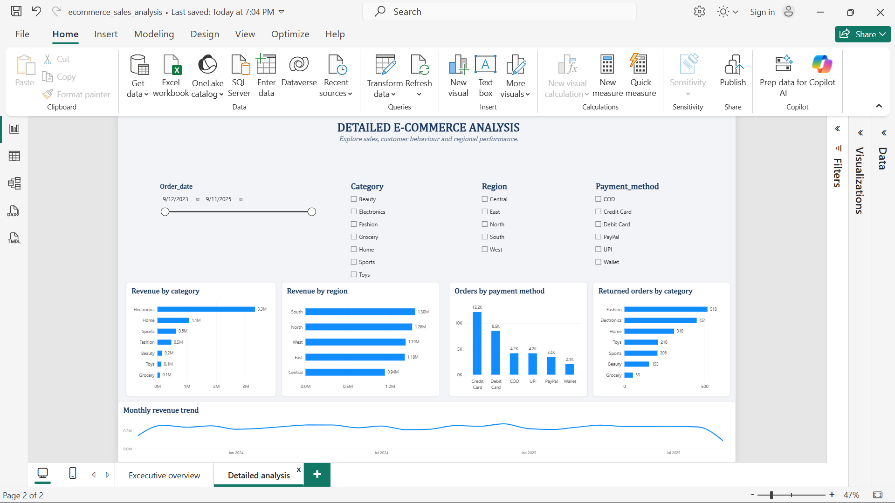
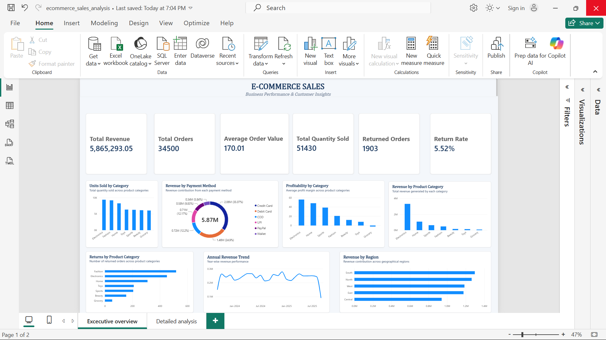

# E-Commerce Sales Analysis

# Business Performance & Customer Insights Dashboard

An end-to-end e-commerce data analytics project focused on understanding sales performance, customer behaviour, product categories, payment preferences, and profitability.

## Project Overview

This project analyses an e-commerce dataset containing **34,500 orders** to identify meaningful business insights and performance trends.

The analysis uses Google Sheets, SQL, and Power BI to explore the data and present findings through an interactive dashboard.

## Tools & Technologies

- Google Sheets – Data cleaning and exploratory analysis
- SQL – Data querying and analysis
- Power BI – Data visualisation and dashboard development

## Key Performance Indicators

- Total Orders: 34,500
- Total Revenue: 5,865,293.05
- Average Order Value: 170.01
- Total Quantity Sold: 51,430
- Returned Orders: 1,903
- Return Rate: 5.52%

## Dashboard Features

- Revenue analysis by product category
- Regional sales performance
- Orders by payment method
- Product category return analysis
- Monthly revenue trends
- Profitability analysis

## Project Objectives

- Evaluate overall sales performance.
- Identify high-performing product categories.
- Understand customer purchasing patterns.
- Analyse regional revenue contribution.
- Examine product returns and profitability.
- Present insights through an interactive dashboard.
- 

# Project Status

Completed: Initial data analysis and Power BI dashboard.

Further enhancements and documentation are in progress.

## Dashboard Preview

### Executive Overview

### Detailed Analysis

## Key Business Insights

- Analysed 34,500 e-commerce orders.
- Total revenue recorded: 5,865,293.05.
- Average order value: 170.01.
- Total quantity sold: 51,430 units.
- Overall return rate: 5.52%.

### Category Insights
- Electronics generated the highest revenue.
- Fashion recorded the highest return rate at 8.28%.
- Grocery had the lowest return rate at 1.31%.

### Project Outcome

Developed an interactive Power BI dashboard to explore sales performance, product categories, customer behaviour, payment preferences, regional revenue and profitability.

